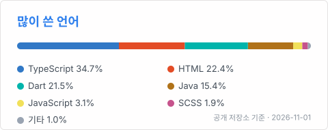

  

<h2 align="center">안녕하세요, 한동관입니다 👋</h2>

<b>사용자가 보는 화면부터 서버까지 이해하는 웹 개발자를 목표로 하고 있습니다.</b>

  
  

  성일정보고등학교 소프트웨어 개발과에 다니고 있습니다. 
  수업과 방과후에서 HTML · CSS · JavaScript, Java, Oracle SQL, 스프링부트를 배웠고, 
  동아리 프로젝트에서는 React와 TypeScript로 웹 화면을 맡았습니다.

---

### 🛠 다뤄 본 기술

  
  
  
  
  
  

  
  
  
  
  

### 📁 프로젝트

| 프로젝트 | 내용 | 맡은 일 |
| --- | --- | --- |
| [잔디로그](https://glog-front.vercel.app) | GitHub 잔디와 기록글로 한 주 활동을 판정하는 동아리 개발 습관 플랫폼 | 웹 프론트엔드 (React · TypeScript) |
| [Young Trip](https://github.com/2026-tmax-it-school/TMAXyoungkk) | 단톡방에 나온 장소를 날짜별 시간표와 지도 루트로 바꿔 주는 여행 계획 앱 | 메인 책임, 앱 · 서버 개발 |
| [들어갈까](https://github.com/hanbg191919-eng/APP-GO) | 가구 치수를 넣으면 우리 집 방에 들어가는지 알려 주는 앱 | 혼자 기획부터 서버 · 앱까지 |

### 📊 GitHub

  
  

